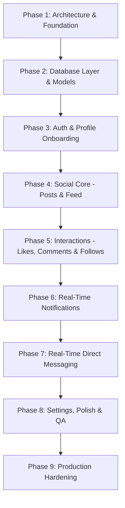

# SocialHub — Engineering Roadmap & UI/UX Design System

## 1. Design System & UI/UX Architecture

SocialHub is crafted with an original, sophisticated visual identity centered on an elegant violet / indigo primary palette. It emphasizes cleanliness, fluid micro-interactions, dark/light contrast harmony, and responsive layouts across mobile, tablet, and desktop viewports.

### 1.1 Color Palette & Design Tokens

| Token Name | Hex Code / Tailwind Class | Application |
| :--- | :--- | :--- |
| **Brand Primary (Violet)** | `#6366F1` (`indigo-500`) / `#7C3AED` (`violet-600`) | Primary CTA buttons, active state indicators, focus rings |
| **Brand Hover / Glow** | `#4F46E5` (`indigo-600`) / `rgba(99, 102, 241, 0.15)` | Hover states, glowing cards, accent highlights |
| **Surface Dark** | `#0F172A` (`slate-900`) / `#1E293B` (`slate-800`) | Elevated card panels, sidebar navigation, modals |
| **Surface Light** | `#FFFFFF` (`white`) / `#F8FAFC` (`slate-50`) | Primary clean backgrounds in light mode |
| **Text Primary** | `#0F172A` (light mode) / `#F8FAFC` (dark mode) | Headlines, post content, conversation messages |
| **Text Muted** | `#64748B` (`slate-500`) / `#94A3B8` (`slate-400`) | Timestamps, handle labels, metadata |
| **Success & Like** | `#EC4899` (`pink-500` for hearts) / `#10B981` (`emerald-500`) | Like toggle animations, online presence dot |
| **Border & Divider** | `#E2E8F0` (`slate-200`) / `#334155` (`slate-700`) | Subtle card separators, input borders |

### 1.2 Layout & Viewport Breakpoints
- **Mobile (< 768px)**:
  - Top header with logo, search trigger, and notifications icon.
  - Sticky bottom tab bar (Home Feed, Explore, Messages [with badge], Profile).
  - Floating Action Button (FAB) for post creation.
- **Tablet (768px – 1024px)**:
  - Collapsed icon-only side navigation bar.
  - Single primary feed container (max-w-2xl) centered.
- **Desktop (1024px+)**:
  - Three-column layout:
    1. **Left Rail (w-64)**: Brand logo, full navigation list, user profile pill, "New Post" primary button.
    2. **Center Feed (flex-1 max-w-2xl)**: Dynamic post creator, feed filters (Following / For You), post stream.
    3. **Right Rail (w-80)**: Live search bar, "Who to Follow" recommendations, trending topics, active direct chat widget.

---

## 2. Interface Blueprint & Blade Component Hierarchy

### 2.1 Reusable Blade Component Catalog

```
resources/views/components/
├── ui/
│   ├── button.blade.php           # Primary, secondary, outline, danger, icon-only
│   ├── input.blade.php            # Form inputs with floating labels & validation error states
│   ├── textarea.blade.php         # Auto-expanding post & comment input
│   ├── modal.blade.php            # Alpine-driven backdrop & accessible dialog window
│   ├── dropdown.blade.php         # Contextual menu (options, share, report)
│   ├── badge.blade.php            # Count badge for unread messages/notifications
│   └── toast.blade.php            # Global floating toast for alerts & live events
├── layout/
│   ├── navigation.blade.php       # Left sidebar / bottom mobile bar
│   ├── header.blade.php           # Top bar for title, breadcrumbs, search
│   └── right-sidebar.blade.php    # Suggested users, search bar, active contacts
├── post/
│   ├── card.blade.php             # Individual post card with author, content, media gallery
│   ├── creator.blade.php          # Interactive compose box with image dropzone
│   ├── action-bar.blade.php       # Like, comment, share, bookmark buttons with live counts
│   └── media-grid.blade.php       # Adaptive 1 to 4 image grid layout
├── comment/
│   ├── thread.blade.php           # Thread container with nested replies indentation
│   └── item.blade.php             # Single comment with author avatar and reply action
├── chat/
│   ├── conversation-list.blade.php# Scrollable inbox list with unread markers & avatars
│   ├── message-bubble.blade.php   # Incoming vs outgoing chat bubble with timestamps
│   ├── message-input.blade.php    # Input bar with media attachment and send trigger
│   └── typing-indicator.blade.php # Animated 3-dot presence indicator
└── user/
    ├── avatar.blade.php           # Circular image with size variants (sm, md, lg, xl) and status dot
    ├── follow-button.blade.php    # Dynamic Follow/Unfollow toggle button
    └── card-mini.blade.php        # User preview card on hover or in suggested rails
```

---

### 2.2 Core Page Specifications

#### 1. Authentication (Login & Register)
- **Path**: `/login`, `/register`
- **Visuals**: Split-screen design on desktop (Left: violet/indigo visual mesh gradient with brand typography; Right: sleek glassmorphism login form).
- **Features**: Real-time username availability validation, toggleable password visibility, remember me checkbox, instant error feedback.

#### 2. Main Feed
- **Path**: `/` or `/feed`
- **Layout**: 3-column desktop layout.
- **Features**:
  - Feed toggle tabs: **Following** (chronological posts from followed accounts) vs **For You** (curated engagement-based feed).
  - Quick Post Creator at top with image upload preview, character counter (2,000 max), and visibility selector.
  - Infinite scroll / cursor-based pagination with skeleton loading cards.
  - Optimistic UI for like button (heart fills instantly, rolls back if network error).

#### 3. Explore & Discovery
- **Path**: `/explore`
- **Features**:
  - Live instantaneous user and post search bar.
  - Category / hashtag explorer tabs.
  - "Trending Creators" cards with instant Follow button.
  - Media masonry gallery for visual post discovery.

#### 4. User Profile
- **Path**: `/@{username}`
- **Features**:
  - Full-width banner image with overlapping high-resolution circular avatar.
  - Display name, `@username`, bio with clickable links/mentions, join date, location.
  - Follower & Following count pills (click opens follower modal list).
  - Action buttons: "Edit Profile" (own profile) or "Follow / Following" + "Send Message" (other profile).
  - Profile sub-tabs: **Posts**, **Replies**, **Media**, **Likes**.

#### 5. Direct Messages (Real-Time Chat)
- **Path**: `/messages`, `/messages/{conversationId}`
- **Layout**: Two-pane split view (Left: conversations list with latest message snippet and unread dot; Right: active chat window).
- **Features**:
  - Instant WebSocket messaging via Laravel Reverb.
  - Auto-scrolling to bottom on new incoming messages.
  - Live typing presence indicator: *"Sophia is typing..."*
  - Read receipts (double checkmarks) and delivery state.
  - Media attachment preview in chat.

#### 6. Notifications
- **Path**: `/notifications`
- **Features**:
  - Filter pills: **All**, **Mentions**, **Likes**, **Comments**, **Follows**.
  - Visual distinction between unread (soft violet background tint) and read items.
  - Single-click "Mark all as read" button.
  - Direct contextual navigation to post or user profile on item click.

#### 7. Settings
- **Path**: `/settings`
- **Sub-pages**:
  - **Account**: Username, email, password update.
  - **Profile**: Bio, location, website, avatar crop, banner upload.
  - **Privacy**: Account privacy toggle (public vs approval-only followers), notification preferences.
  - **Appearance**: Dark / Light theme selector.

---

## 3. Phased Implementation Roadmap



### Detailed Phase Breakdown

| Phase | Milestone | Key Deliverables | Verification Strategy |
| :--- | :--- | :--- | :--- |
| **Phase 1** *(Current)* | **Architecture & Foundation** | System specification, database schema, ER diagrams, roadmap, environment inspection. | Architectural sign-off from lead engineer. |
| **Phase 2** | **Database & Domain Entities** | Initialize Git repo, configure MySQL, generate 11 migrations, define Eloquent models, factories, seeders. | Run `php artisan migrate:fresh --seed`, Pest unit tests for model relations. |
| **Phase 3** | **Authentication & Profiles** | Login, register, logout controllers, session protection, profile editing, avatar & banner upload action. | Feature tests for auth flows, validation rules, and file upload security. |
| **Phase 4** | **Social Core: Feed & Posts** | Create post action, media processor, home feed query with cursor pagination, Blade layout & post card. | Feature tests for post creation, feed authorization, and media binding. |
| **Phase 5** | **Interactions: Likes, Comments, Follows** | ToggleLikeAction, CreateCommentAction (with nested replies), FollowUserAction, explore page search. | Pest tests for like idempotency, cascade deletions, follow privacy checks. |
| **Phase 6** | **Real-Time Notifications** | Install Laravel Reverb, configure broadcasting, create notification classes, live toast & unread counter. | WebSocket broadcast tests, database notification persistence verification. |
| **Phase 7** | **Real-Time Direct Messaging** | Conversation list, private chat room, `MessageSent` event over Reverb, Echo client listener, presence typing. | Multi-user chat tests, authorization channel leak prevention tests. |
| **Phase 8** | **UI Refinement, Design System & QA** | Violet/indigo design tokens, responsive polish (mobile/tablet/desktop), accessibility audits, Pest test suite. | 100% passing Pest test suite, zero console errors on responsive viewports. |
| **Phase 9** | **Performance & Production Hardening** | N+1 query optimization, rate limiters, security headers, queue worker configuration. | Query count profiling with Laravel Pail/Tinker, load testing simulation. |

